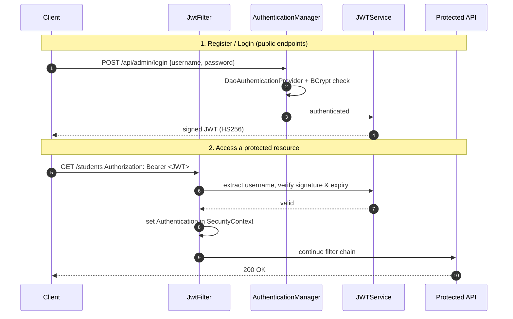

# JWT Authentication with Spring Security 6

A stateless REST authentication service built with **Spring Boot 3**, **Spring Security 6** and **JSON Web Tokens (JWT)**. Users register with a BCrypt-hashed password stored in MySQL. They log in to receive a signed JWT and then call protected endpoints with a `Bearer` token. No server-side session is kept.

This is the authentication module of an e-commerce admin portal (`Ecomm-Admin-Portal`). It shows how to set up Spring Security's filter chain from scratch with the current, non-deprecated component-based configuration (no `WebSecurityConfigurerAdapter`).


---

## Highlights

- **Stateless security**: `SessionCreationPolicy.STATELESS`. Each request is authenticated only by its JWT.
- **Custom JWT filter**: `JwtFilter` extends `OncePerRequestFilter` and runs before `UsernamePasswordAuthenticationFilter`. It validates the token and fills the `SecurityContext`.
- **Database-backed users**: a custom `UserDetailsService` (`MyUserDetailsService`) loads users through Spring Data JPA. `UserPrincipal` adapts the `Users` entity to Spring's `UserDetails`.
- **Password hashing**: `BCryptPasswordEncoder` with strength 12, wired into a `DaoAuthenticationProvider`.
- **Token handling with JJWT 0.12**: HMAC-SHA256 signing, plus subject, issued-at and expiration claims, using the fluent builder/parser API.
- **Externalised configuration**: database credentials come from environment variables, not source code.

---

## Architecture

### Request flow



### Security filter chain (`SecurityConfig`)

```java
http.csrf(c -> c.disable())                       // stateless API: no cookies, so no CSRF surface
    .authorizeHttpRequests(r -> r
        .requestMatchers("/api/admin/login", "/api/admin/register").permitAll()
        .anyRequest().authenticated())
    .httpBasic(Customizer.withDefaults())
    .sessionManagement(s -> s.sessionCreationPolicy(SessionCreationPolicy.STATELESS))
    .addFilterBefore(jwtFilter, UsernamePasswordAuthenticationFilter.class);
```

---

## Tech stack

| Layer          | Technology                                   |
|----------------|----------------------------------------------|
| Language       | Java 21                                      |
| Framework      | Spring Boot 3.3.2 (Web, Security, Data JPA)  |
| Authentication | Spring Security 6, JJWT 0.12.5               |
| Persistence    | MySQL 8, Hibernate / JPA                     |
| Build          | Maven (wrapper included)                     |
| Testing        | JUnit 5, Spring Boot Test, Spring Security Test |

---

## Project structure

```
src/main/java/com/ecomm/admin
├── EcommAdminApplication.java      # Spring Boot entry point
├── config
│   ├── SecurityConfig.java         # SecurityFilterChain, AuthenticationProvider, AuthenticationManager
│   └── JwtFilter.java              # OncePerRequestFilter that validates Bearer tokens
├── controller
│   ├── UserController.java         # /api/admin/register, /api/admin/login
│   └── StudentController.java      # sample protected resource
├── model
│   ├── Users.java                  # JPA entity
│   ├── UserPrincipal.java          # UserDetails adapter
│   └── Student.java
├── repo
│   └── UserRepo.java               # Spring Data JPA repository
└── service
    ├── JWTService.java             # token generation, parsing, validation
    ├── MyUserDetailsService.java   # loads users from the database
    └── UserService.java            # registration (BCrypt) and login
```

---

## API

| Method | Endpoint              | Auth   | Description                          |
|--------|-----------------------|--------|--------------------------------------|
| POST   | `/api/admin/register` | Public | Register a user (password is hashed) |
| POST   | `/api/admin/login`    | Public | Authenticate and receive a JWT       |
| GET    | `/students`           | JWT    | List students (sample resource)      |
| POST   | `/students`           | JWT    | Add a student (sample resource)      |

### Example

```bash
# Register
curl -X POST http://localhost:8181/api/admin/register \
     -H "Content-Type: application/json" \
     -d '{"username":"alice","password":"S3cure!pass"}'

# Login – returns the JWT as plain text
TOKEN=$(curl -s -X POST http://localhost:8181/api/admin/login \
     -H "Content-Type: application/json" \
     -d '{"username":"alice","password":"S3cure!pass"}')

# Call a protected endpoint
curl http://localhost:8181/students -H "Authorization: Bearer $TOKEN"
```

A request without a token returns `401 Unauthorized`.

---

## Getting started

### Prerequisites

- JDK 21
- MySQL 8 running locally (or reachable through `DB_URL`)

### 1. Create the database

```sql
CREATE DATABASE authorization;
```

Hibernate creates the `users` table on startup (`ddl-auto=update`).

### 2. Configure credentials

The datasource reads its settings from environment variables:

| Variable      | Required | Default                                                                    |
|---------------|----------|----------------------------------------------------------------------------|
| `DB_PASSWORD` | Yes      | none                                                                       |
| `DB_USERNAME` | No       | `root`                                                                     |
| `DB_URL`      | No       | `jdbc:mysql://localhost:3306/authorization?useSSL=false&serverTimezone=UTC` |

```bash
# Linux / macOS
export DB_PASSWORD=your_password

# Windows (PowerShell)
$env:DB_PASSWORD="your_password"
```

### 3. Run

```bash
./mvnw spring-boot:run        # Windows: mvnw.cmd spring-boot:run
```

The application starts on **http://localhost:8181**.

---

## Design notes and roadmap

Choices made for this module, and what I would add before a production rollout:

- **Signing key**: a fresh HMAC-SHA256 key is generated in memory at startup, so tokens become invalid after a restart. For production, the key would come from a secret store (e.g. Vault or AWS Secrets Manager) so multiple instances share it.
- **Refresh tokens**: add short-lived access tokens plus refresh-token rotation.
- **Roles and authorities**: put roles in the JWT claims and use method-level security (`@PreAuthorize`).
- **Response DTOs and validation**: return DTOs instead of entities, and add Bean Validation on request bodies.
- **Error handling**: add a custom `AuthenticationEntryPoint` and `@ControllerAdvice` for consistent JSON error responses.
- **Tests**: add integration tests with `MockMvc` + `spring-security-test` and Testcontainers for MySQL.
- **API docs**: add OpenAPI / Swagger UI through springdoc.

---

## Author

**Alam** – Java full-stack developer (Java / Spring Boot, Next.js) with 10+ years of experience
GitHub: [@alamsoftware68](https://github.com/alamsoftware68)
